# ADR-0061 — Tassonomia multidimensionale e metamodel dei processi

- **Status**: ACCETTATO il 2026-11-22 da Enzo Spenuso, alle 03:21 UTC (04:21 ora di Roma), nel thread «Scrivere l'ADR su tassonomia e metamodel dei processi»: «l'ADR è accettato, con le tre raccomandazioni in esso definite e diventa subito operativo». Proposto lo stesso giorno
- **Date**: 2026-11-22
- **Redatto da**: Claude Code, thread «Scrivere l'ADR su tassonomia e metamodel dei processi»
- **Richiesta**: Enzo Spenuso, 2026-11-22 alle 03:09 UTC (04:09 ora di Roma): ha incollato un testo di progettazione («tassonomia multidimensionale associata a un metamodel») e ha chiesto di farne un file `.md` con infografica ricca nella documentazione del repo, domandando se fosse un ADR. Lo è: fissa la forma con cui Heuresys descrive, classifica, riusa e configura i processi, e vincola i lavori che verranno
- **Poggia su**: ADR-0049 (le attività appartengono a un processo), ADR-0059 (allineamento e consolidamento), ADR-0044 (la partecipazione appartiene al posto), ADR-0048 (personalizzazioni del tenant), ADR-0043 (perimetro di settore), ADR-0035 (ritirare non è cancellare), ADR-0040 e ADR-0050 D6 (l'agente legge ciò che legge la persona), ADR-0053 e ADR-0056 (capacità e principi agentici), ADR-0060 (applet)
- **Precisa**: la definizione di «processo» che oggi le pagine usano in cinque sensi diversi (piano `docs/piani/PIANO_processi-e-progetti-sistematici_20261118.md`, §1)
- **Non tocca**: gli invarianti di `CLAUDE.md` (in particolare I1, I3/I4, I5, I9, RD-08, RD-09, I21); nessuna migrazione, nessuna rotta, nessun dato: questo ADR è solo documentazione. Il codice e le migrazioni arrivano dopo, a passi piccoli (§7)

> **In parole semplici.**
> 1. Per i processi servono cinque cose distinte, e ognuna ha il suo posto: la **tassonomia** dice dove sta un processo e come si classifica; il **metamodel** dice con quali oggetti lo si descrive; il **blueprint** è la definizione riutilizzabile di un processo concreto; la **configurazione** lo adatta a una impresa; l'**istanza** è una singola esecuzione.
> 2. Un processo si colloca in una gerarchia a cinque livelli (dominio, famiglia, processo, attività, compito) e si classifica anche per dimensioni indipendenti (finalità, beneficiario, perimetro, criticità, standardizzazione…), perché la sola gerarchia non basta.
> 3. Il blueprint non nomina mai una persona: nomina ruoli di processo astratti. Sarà la configurazione del tenant a collegarli a posizioni, e le persone si risolvono dalle assegnazioni valide alla data che interessa. È il modello centrato sulla posizione (I1) applicato ai processi.
> 4. Il profilo di applicabilità **sceglie**, la variante **cambia la struttura**, la configurazione **dà i valori**. Una soglia o un destinatario diversi non giustificano una variante.
> 5. Gli agenti leggono e descrivono i processi attraverso il metamodel, controllano da soli i criteri di robustezza e propongono varianti e classificazioni; non scrivono mai niente senza il sì di chi ne ha il potere (§6).

---

## §1 — Contesto

Heuresys è una piattaforma agentica, guidata dall'intelligenza artificiale, specializzata nella modellazione organizzativa. Il processo è l'oggetto in cui l'organizzazione diventa lavoro: chi fa che cosa, con quali regole, per ottenere quale risultato. Oggi advanced lo rappresenta bene in alcuni punti e in modo frammentato in altri.

**Che cosa c'è oggi** (letto dalle migrazioni e dai piani del repo il 2026-11-22; i conteggi si rimisurano con i comandi di §8, non si fidano di questo testo):

| oggetto di oggi | dove vive | a che cosa corrisponde in questo ADR |
|---|---|---|
| famiglia e variante di settore (per esempio `FIN_BANKING`, `RTL_BANK`) | `sys_blueprint_families`, `sys_blueprint_variants`, versioni in `sys_blueprint_variant_versions` | contenitore dei blueprint di un settore e profilo di applicabilità |
| processo del modello | `sys_blueprint_process_registry` | blueprint generale (L3), per versione di variante |
| fasi del contenuto del modello | `sys_blueprint_content_process_steps` (000458), con esecutore `POSIZIONE`, `RUOLO` o `AGENTE` | attività L4 del blueprint |
| attivazione del modello da parte di un tenant | `sys_blueprint_activations`, `sys_blueprint_overrides` | configurazione aziendale, in forma ancora ridotta |
| processo del tenant | `sys_tenant_processes` (000462), con livello 1 o 2 e genitore (000498) | processo configurato del tenant; i sottoprocessi P01-P30 sono il livello 2 |
| attività del processo del tenant | `sys_tenant_process_steps` (000462, 131 attività APQC PCF Banking per i 21 processi di RTL) | attività L4 configurate, con l'unità che le esegue |
| partecipazione al processo | `sys_process_participants` (000179), `sys_organization_unit_processes` | ruoli di processo legati a posizioni e unità |
| indicatori del processo | `sys_process_kpi_templates` (000015) | KPI del blueprint, ancora senza formula e fonte dichiarate come campi propri |
| richieste di approvazione e progetti legati a un processo | colonne di processo su richieste e progetti (000462), `sys_project_phases` (000503) | istanze, in forma parziale |

**Che cosa manca**, e perché serve questo ADR:

1. La parola «processo» copre ancora cinque oggetti diversi (piano `docs/piani/PIANO_processi-e-progetti-sistematici_20261118.md`, §1). Manca un linguaggio unico che dica quale è quale.
2. Il livello 1 o 2 di `sys_tenant_processes` dice «processo» o «sottoprocesso» e **non coincide** con i livelli L1-L5 proposti qui: i due ordini di grandezza vanno tenuti separati (§2, nota).
3. I compiti (L5) non esistono come oggetto. Le classificazioni per faccette non esistono: ogni dimensione oggi è o assente o un campo isolato.
4. I ruoli di processo astratti esistono solo in parte (esecutore `RUOLO` nel contenuto del modello): la configurazione del tenant che li lega a posizioni con regole esplicite non ha ancora una forma unica.
5. Le relazioni fra oggetti di processo sono colonne di chiave esterna, senza tipo semantico, senza condizioni, validità e provenienza.
6. Non c'è una regola scritta che dica quando un blueprint è «pubblicabile», né che cosa distingue una variante da un parametro.
7. Un'istanza (per esempio una richiesta di approvazione) non conserva quale versione del blueprint e quale configurazione l'hanno governata.

Il testo di progettazione che Enzo ha incollato il 2026-11-22 risponde a queste lacune con una struttura portante: **gerarchia dei processi, classificazioni per faccette, blueprint semantico, regole di configurazione e governance delle versioni**. Questo ADR la adotta e la collega a ciò che esiste.

## §2 — Decisione

### D1 — Definizione dell'oggetto centrale

> Un **processo di business** è un insieme coordinato di attività, decisioni e interazioni, attivato da eventi o condizioni, che utilizza risorse e informazioni per produrre risultati verificabili destinati a beneficiari identificati, entro responsabilità, vincoli e criteri di prestazione definiti.

Il blueprint riutilizzabile di un processo specifica anche **che cosa rimane invariato, che cosa può essere configurato e quali variazioni sono ammesse**.

### D2 — I cinque oggetti, tenuti separati

| oggetto | risponde alla domanda | non è |
|---|---|---|
| **Tassonomia** | dove si colloca il processo e come lo si classifica | una descrizione del flusso |
| **Metamodel** | con quali oggetti lo si descrive e come sono collegati | un processo concreto |
| **Blueprint** | qual è la definizione riutilizzabile di un processo concreto | la configurazione di un'impresa |
| **Configurazione aziendale** | come quel blueprint si adatta a una determinata impresa (tenant) | il blueprint stesso |
| **Istanza** | che cosa è successo in una singola esecuzione | la definizione del processo |

La separazione permette di tenere distinti **il framework generale**, **i riferimenti di settore** (come `FIN_BANKING`) e **le configurazioni dei singoli tenant**, in coerenza con I21 e ADR-0043: il settore sta nel modello e nel datastore; il tenant ne vede il proprio perimetro.

### D3 — Gerarchia: dove si colloca il processo (cinque livelli)

La gerarchia esprime **decomposizione**; il flusso esprime ordine e condizioni di esecuzione. Due attività dello stesso processo possono non essere consecutive.

| livello | oggetto | definizione | esempio HR |
|---|---|---|---|
| L1 | Dominio di processo | grande ambito di gestione aziendale | Gestire il capitale umano |
| L2 | Famiglia di processi | raggruppamento di processi con finalità correlate | Acquisire e inserire persone |
| L3 | Processo | trasformazione con confini, risultato e responsabilità definiti | Gestire la selezione |
| L4 | Attività | unità significativa di lavoro del processo | Valutare i candidati |
| L5 | Compito | azione descritta al livello operativo necessario | Registrare l'esito del colloquio |

Come riferimento esterno vale la struttura a cinque livelli di APQC PCF (categoria, gruppo di processi, processo, attività, compito), tenuta distinta dalla rappresentazione del flusso operativo. La corrispondenza fra i nostri livelli e quelli APQC è una **mappatura** (D9), non un'identità.

Tre oggetti complementari **non sono livelli fissi**:

| oggetto | funzione |
|---|---|
| Percorso end-to-end | collega processi di famiglie o domini diversi per ottenere un risultato complessivo |
| Fase | raggruppa attività per facilitarne comprensione e governo |
| Sottoprocesso | incapsula un flusso interno, eventualmente riutilizzabile in più processi |

> **Nota di non confusione.** Il campo `tenant_process_level` di `sys_tenant_processes` vale 1 (processo) o 2 (sottoprocesso): dice quanto è annidato un processo **dentro un altro processo** del tenant. Non è il livello L1-L5. Un sottoprocesso del tenant resta un oggetto L3 che ne incapsula un altro (D3, «Sottoprocesso»). Chi implementerà la tassonomia non riusa quel campo per i cinque livelli.

### D4 — Classificazione per faccette: come si classifica il processo

La sola gerarchia non basta. Ogni processo è classificabile lungo dimensioni **indipendenti**, anche con più valori quando serve (un processo può avere beneficiari interni ed esterni insieme).

| dimensione | valori o riferimenti |
|---|---|
| Finalità aziendale | governo e indirizzo; realizzazione del valore; supporto |
| Dominio funzionale | HR, commerciale, operations, finanza, IT, rischio, ecc. |
| Beneficiario | cliente esterno; cliente interno; partner; autorità; altri stakeholder |
| Perimetro | interno a un'unità; interfunzionale; interaziendale |
| Modalità di lavoro | flusso prescritto; gestione di caso; ibrida |
| Attivazione | evento; calendario; richiesta; condizione o soglia |
| Partecipazione tecnologica | manuale; assistita; automatizzata; mista |
| Applicabilità | settore, sottosettore, dimensione, modello operativo, giurisdizione |
| Criticità | impatto economico, operativo, normativo, sui dati e sulle persone |
| Ripetitività e domanda | frequenza, volumi, stagionalità, variabilità |
| Standardizzazione | comune; parametrizzabile; variante settoriale; specifico aziendale |

**Regola sulla criticità.** «Alta» o «bassa» senza una regola di attribuzione producono confronti inaffidabili. Ogni scala di criticità dichiara i criteri espliciti con cui si assegna un valore, e il valore porta con sé il criterio applicato.

**Regola sul formato.** I valori delle faccette sono vocabolari chiusi (RD-08: `varchar(N)` con `CHECK`, mai ENUM di PostgreSQL), con codice stabile e denominazione italiana traducibile (D8, criterio 8).

### D5 — Metamodel: che cosa contiene la scheda canonica del blueprint

| area | oggetti e attributi essenziali |
|---|---|
| Identità | codice stabile, denominazione, definizione, versione, stato, lingua |
| Finalità e valore | scopo, bisogno soddisfatto, beneficiari, risultati attesi |
| Confini | evento iniziale, condizioni di ingresso, condizioni di conclusione, inclusioni ed esclusioni |
| Applicabilità | contesti ammessi, prerequisiti, dipendenze, condizioni di attivazione |
| Input e output | oggetti informativi o materiali, produttori, destinatari, criteri di qualità |
| Struttura del lavoro | fasi, attività, compiti, sottoprocessi, componenti richiamabili |
| Comportamento | sequenze, parallelismi, eventi, attese, messaggi, percorsi alternativi |
| Decisioni e regole | decisioni, dati richiesti, criteri, soglie, politiche e autorità decisionali |
| Responsabilità | process owner, ruoli di processo, responsabilità operative e approvative |
| Competenze e risorse | competenze richieste, livelli attesi, capacità, strumenti e risorse |
| Dati e sistemi | entità coinvolte, applicazioni, interfacce, fonti autorevoli |
| Rischi e controlli | rischi, obiettivi di controllo, controlli, evidenze, separazione dei compiti |
| Prestazioni | KPI, formule, SLA, obiettivi, fonti, frequenze e criteri di valutazione |
| Eccezioni e recupero | errori, escalation, sospensioni, annullamenti, rilavorazioni, compensazioni |
| Configurabilità | parametri, varianti, vincoli, valori predefiniti, estensioni ammesse |
| Governance | autore, revisore, approvatore, validità, provenienza, modifiche, compatibilità |

**Output, outcome, KPI restano tre oggetti distinti:**

| oggetto | che cos'è | esempio |
|---|---|---|
| Output | ciò che il processo produce | un piano formativo approvato |
| Outcome | l'effetto perseguito | la riduzione di uno specifico divario di competenze |
| KPI | la misura con cui si osservano prestazioni o risultati | riduzione del gap sulle competenze prioritarie |

Produrre l'output non dimostra il raggiungimento dell'outcome.

### D6 — Architettura del riuso: sette oggetti

| oggetto | contenuto | esempio |
|---|---|---|
| Metamodel | regole comuni con cui descrivere tutti i processi | ogni processo dichiara confini e risultati |
| Componente riutilizzabile | unità richiamabile con un proprio contratto | approvazione; verifica documentale |
| Blueprint generale | definizione indipendente da una specifica azienda | gestire l'apprendimento |
| Profilo di applicabilità | regole che selezionano contenuti e vincoli pertinenti | impresa bancaria con rete di filiali |
| Variante | differenza strutturale controllata rispetto al blueprint | percorso formativo soggetto a obblighi specifici |
| Configurazione aziendale | parametri, assegnazioni e integrazioni dell'impresa | posizioni approvative, soglie, sistemi |
| Istanza di processo | singola esecuzione legata a versioni precise | piano formativo 2027 della filiale A |

**Il profilo seleziona, la variante modifica la struttura, la configurazione valorizza i parametri.**

**Quando si introduce una variante.** Solo quando cambiano **attività, decisioni, controlli o risultati obbligatori**. Non si introduce una variante per cambiare un destinatario o una soglia già configurabili: quelli sono parametri.

**Contratto del componente.** Ogni componente riutilizzabile dichiara un contratto minimo: input, output, precondizioni, postcondizioni, errori ed eventuali effetti prodotti. Così si compongono processi senza dipendere da dettagli impliciti.

### D7 — Relazioni semantiche tipizzate

Niente collegamenti generici tipo «associato a». Le relazioni ammesse sono queste, e ogni nuova relazione entra con un nuovo ADR o con una modifica motivata di questo.

| relazione | significato |
|---|---|
| `è_parte_di` | decomposizione strutturale |
| `precede` | ordine del flusso, eventualmente condizionato |
| `richiama` | utilizzo di un componente o sottoprocesso |
| `è_attivato_da` | evento o condizione di avvio |
| `consuma` / `produce` | input e output |
| `è_governato_da` | politica, regola o vincolo |
| `è_eseguito_da` | ruolo operativo |
| `richiede` | competenza, risorsa o prerequisito |
| `è_misurato_da` | indicatore |
| `è_presidiato_da` | controllo |
| `specializza` | derivazione controllata da un blueprint |
| `è_mappato_a` | corrispondenza con una classificazione esterna |

Ogni relazione può portare **condizioni, validità e provenienza**. Il mapping verso una voce APQC, per esempio, è `esatto`, `più ampio`, `più ristretto` o `parziale`.

### D8 — Collegamento con il modello centrato sulla posizione (I1)

Nel blueprint il partecipante è un **ruolo di processo astratto** («valutatore», «approvatore», «responsabile della richiesta»), mai una posizione né una persona. Nella configurazione aziendale quel ruolo è collegato a una o più **posizioni** con regole esplicite; le **persone** abilitate si risolvono dalle assegnazioni alle posizioni valide **nel momento pertinente**.

| concetto | esempio |
|---|---|
| Ruolo di processo | approvatore del piano formativo |
| Posizione configurata | responsabile formazione |
| Persona assegnata | titolare della posizione alla data dell'approvazione |
| Competenza richiesta | analisi dei fabbisogni formativi |
| Evidenza | assessment con metodo, data ed esito |
| Indicatore | riduzione del gap su competenze prioritarie |

Tre separazioni da conservare:

1. Process owner, responsabile dell'attività e approvatore possono essere soggetti diversi.
2. La competenza **richiesta dalla posizione** e la competenza **dimostrata dalla persona** sono oggetti distinti.
3. Completamento di un corso, padronanza della competenza e risultato del processo richiedono **evidenze differenti**. I collegamenti fra competenze, apprendimento e KPI dichiarano il criterio di attribuzione e valutazione, senza presupporre un rapporto causale automatico.

Questo è già il disegno di ADR-0044 (la partecipazione appartiene al posto) e di I1 (proprietario e titolare della posizione sono distinti): la decisione D8 lo estende dalla partecipazione a tutto il metamodel.

### D9 — Rappresentazione e standard

| riferimento | impiego |
|---|---|
| APQC PCF | classificazione e corrispondenza con processi di riferimento |
| BPMN | flussi, eventi e interazioni |
| DMN | decisioni e regole decisionali |
| CMMN | lavoro guidato da casi e attività adattive |

**La definizione semantica è indipendente dalla visualizzazione.** Coordinate, colori e disposizione grafica appartengono alla proiezione visuale (stessa scelta di ADR-0009 per i layout dei nodi). Modificare il layout non modifica responsabilità, regole o flusso.

### D10 — Criteri minimi di robustezza: quando un blueprint è pubblicabile

Un blueprint è **pubblicabile** quando soddisfa tutte e otto le condizioni. Sono verificabili a macchina (§6) e diventeranno un controllo di integrità (§7, passo 3).

| # | criterio |
|---|---|
| 1 | Ha identità e versione stabili, con confini e risultati verificabili |
| 2 | Distingue valori obbligatori, configurabili, derivati e non applicabili |
| 3 | Esplicita responsabilità, decisioni, eccezioni e controlli pertinenti |
| 4 | Definisce i KPI con formula, unità, fonte, finestra temporale e trattamento dei dati mancanti |
| 5 | Dichiara dipendenze, varianti compatibili e vincoli di configurazione |
| 6 | Conserva provenienza, approvazioni e storia delle modifiche |
| 7 | Permette di ricostruire quale versione e quale configurazione hanno governato ogni esecuzione |
| 8 | Separa identificativi canonici, codici leggibili e denominazioni traducibili |

La struttura portante che ne risulta è: **gerarchia dei processi + classificazioni per faccette + blueprint semantico + regole di configurazione + governance delle versioni**. È questa combinazione a consentire il riuso fra settori e imprese senza perdere precisione organizzativa e operativa.

## §3 — Infografica

Tutti i diagrammi sono in scala di grigi (regola del progetto) e si leggono anche stampati in bianco e nero.

### 3.1 — Le cinque cose distinte

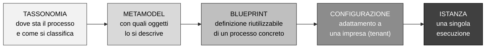

### 3.2 — La gerarchia a cinque livelli e i tre oggetti complementari

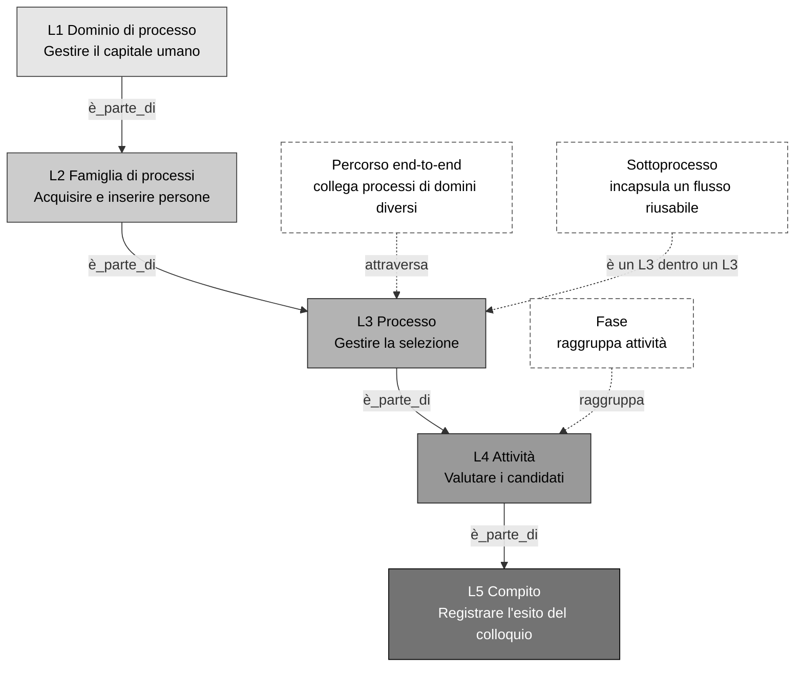

### 3.3 — Le faccette: undici dimensioni indipendenti attorno al processo

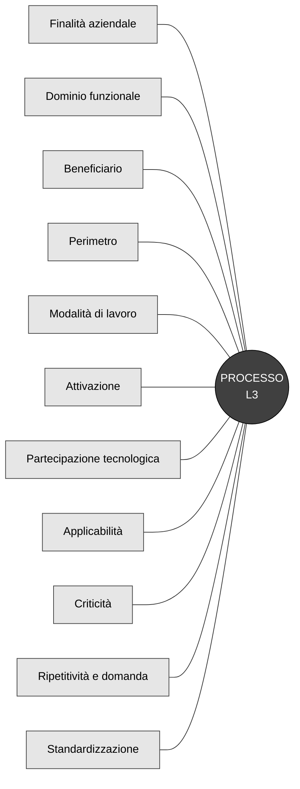

### 3.4 — La catena del riuso: dal metamodel all'esecuzione

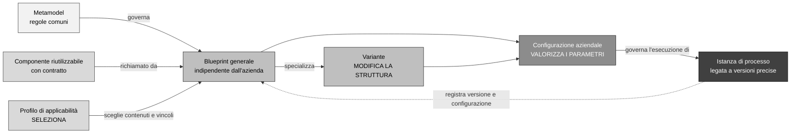

### 3.5 — Quando serve una variante e quando basta un parametro

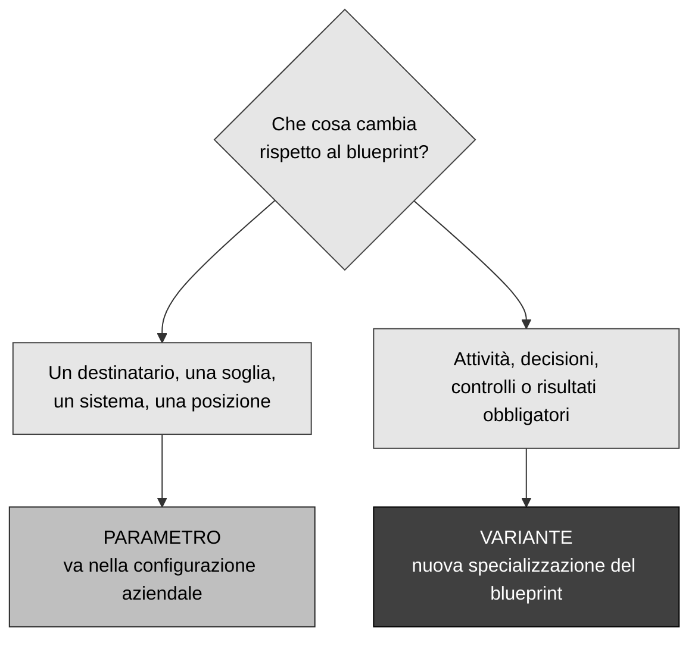

### 3.6 — Le relazioni tipizzate

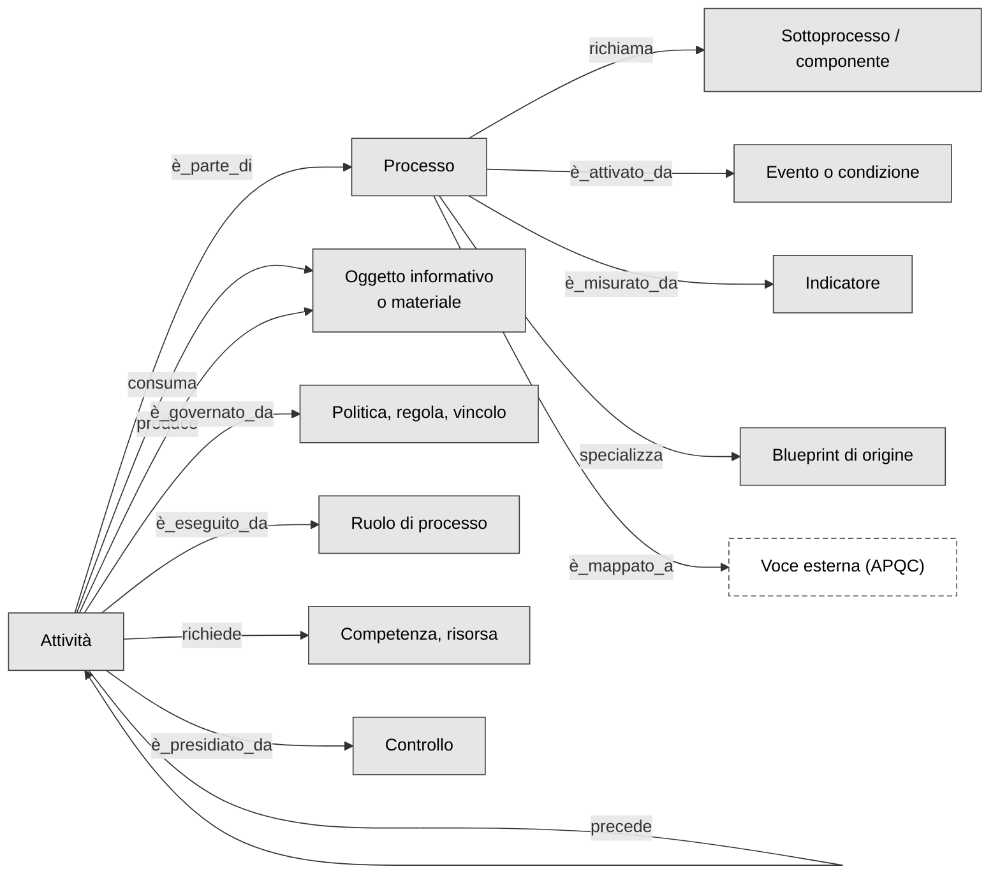

### 3.7 — Dal ruolo di processo alla persona

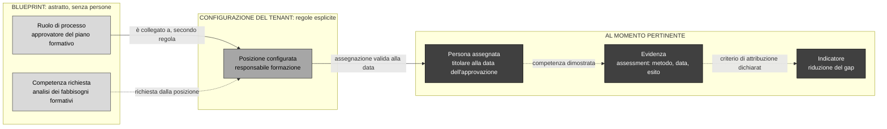

### 3.8 — Output, outcome, KPI

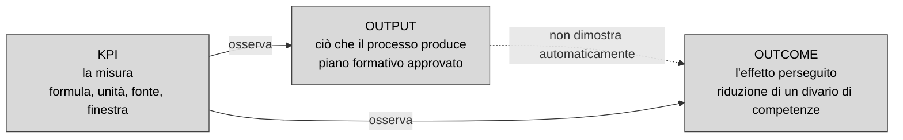

### 3.9 — Gli standard e il loro compito

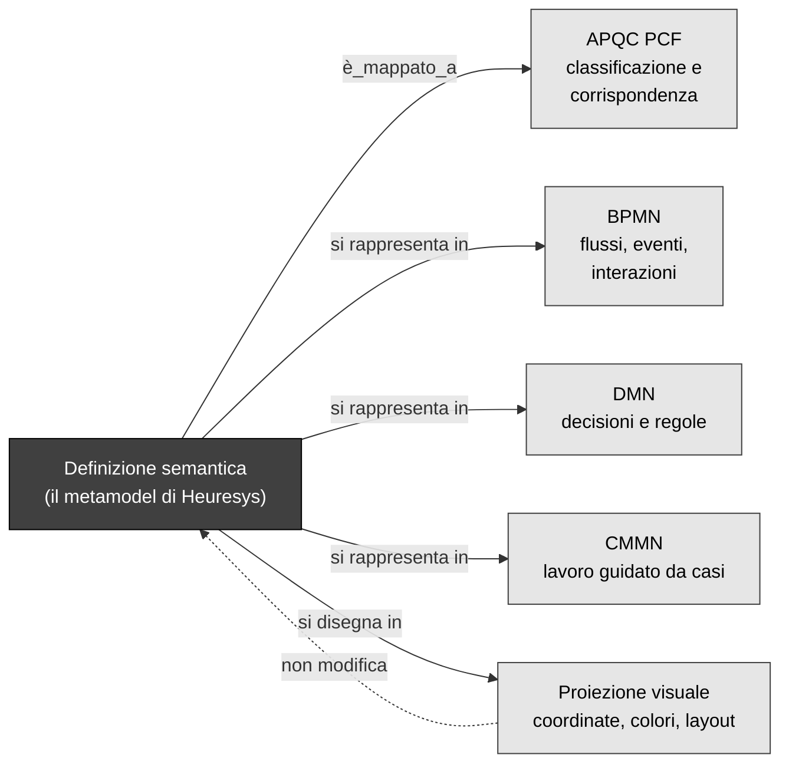

### 3.10 — I criteri di pubblicazione

| # | criterio | chi lo verifica |
|---|---|---|
| 1 | identità e versione stabili, confini e risultati verificabili | controllo statico |
| 2 | valori obbligatori, configurabili, derivati, non applicabili distinti | controllo statico |
| 3 | responsabilità, decisioni, eccezioni e controlli esplicitati | controllo statico, poi revisione umana |
| 4 | KPI con formula, unità, fonte, finestra, dati mancanti | controllo statico |
| 5 | dipendenze, varianti compatibili, vincoli di configurazione | controllo statico |
| 6 | provenienza, approvazioni, storia delle modifiche | controllo sul registro |
| 7 | versione e configurazione ricostruibili per ogni esecuzione | prova dal vivo su un'istanza |
| 8 | identificativo canonico, codice leggibile, denominazione traducibile separati | controllo statico |

## §4 — Come si lega allo stato attuale di advanced

Questo paragrafo vale per RTL Bank (settore `FIN_BANKING`, ATECO 64.19, modello `RTL_BANK`) e per Heuresys System. I conteggi citati sono quelli dei piani e delle migrazioni del 2026-11-18; **si rimisurano prima di usarli** (§8).

### 4.1 — Mappa fra oggetti di oggi e oggetti di questo ADR

```mermaid
flowchart TB
    classDef adr fill:#404040,stroke:#000,color:#fff
    classDef ex fill:#e6e6e6,stroke:#404040,color:#000
    classDef gap fill:#ffffff,stroke:#595959,stroke-dasharray:5 3,color:#000

    subgraph MOD["Lato modello (datastore, per settore e versione)"]
        FAM["sys_blueprint_families / variants<br/>FIN_BANKING, RTL_BANK"]:::ex
        VER["sys_blueprint_variant_versions"]:::ex
        REG["sys_blueprint_process_registry<br/>processi del modello"]:::ex
        STP["sys_blueprint_content_process_steps<br/>fasi, esecutore POSIZIONE/RUOLO/AGENTE"]:::ex
        KT["sys_process_kpi_templates"]:::ex
    end
    subgraph TEN["Lato tenant"]
        ACT["sys_blueprint_activations / overrides"]:::ex
        TP["sys_tenant_processes<br/>livello 1 o 2, genitore"]:::ex
        TS["sys_tenant_process_steps<br/>131 attività APQC (RTL)"]:::ex
        PA["sys_process_participants<br/>sys_organization_unit_processes"]:::ex
    end
    subgraph RUN["Lato esecuzione"]
        AR["richieste di approvazione<br/>con processo e attività"]:::ex
        PJ["progetti, sys_project_phases"]:::ex
    end

    PR["Profilo di applicabilità"]:::adr
    BG["Blueprint generale (L3)"]:::adr
    AT["Attività (L4)"]:::adr
    CF["Configurazione aziendale"]:::adr
    IS["Istanza"]:::adr
    CT["Compito (L5)"]:::gap
    FC["Faccette"]:::gap
    RL["Relazioni tipizzate"]:::gap
    CM["Componenti con contratto"]:::gap

    FAM --> PR
    VER --> BG
    REG --> BG
    STP --> AT
    KT --> BG
    ACT --> CF
    TP --> CF
    TS --> AT
    PA --> CF
    AR --> IS
    PJ --> IS
```

I riquadri tratteggiati sono ciò che oggi **non esiste come oggetto**: compiti L5, faccette, relazioni tipizzate, componenti riutilizzabili con contratto.

### 4.2 — Processi e sottoprocessi

Il 2026-11-18 Enzo ha deciso che i processi P01-P30 del prototipo sono **sottoprocessi** dei 21 processi unici del catalogo approvato il 2026-11-10/11 (migrazione 000498: `tenant_process_level` e `tenant_process_parent_id`). In questo ADR un sottoprocesso è «un L3 incapsulato in un altro L3», richiamabile (`richiama`), e quindi la decisione di Enzo resta intatta: cambia solo il nome con cui il metamodel la descrive. Le attività APQC (131 per RTL, 000462) sono L4. I compiti L5 non esistono ancora e **non si inventano**: si introducono dove un'attività ne ha davvero bisogno (§7, passo 5).

### 4.3 — Il consolidamento e l'allineamento

ADR-0059 distingue due modi dello stesso motore: **Allineamento** (vince il modello) e **Consolidamento** (vince il tenant). Il metamodel di questo ADR ne è il vocabolario comune:

- il motore confronta modello e tenant **per oggetto del metamodel** (blueprint, attività, ruolo di processo, KPI) e non per tabella;
- una **variante** del modello è ciò che il Consolidamento adotta quando il tenant ha una struttura diversa e legittima; un **parametro** diverso è solo una configurazione e non genera una variante (D6);
- una decisione presa su un oggetto vale per gli oggetti analoghi, come già prevede ADR-0059 (le decisioni diventano regole);
- RTL Bank, primo tenant in Allineamento secondo ADR-0059, è il banco di prova: i suoi processi di `FIN_BANKING` si classificano per prima con le faccette di D4 e si mappano a APQC con il tipo di corrispondenza di D7.

### 4.4 — Posizione, non dipendente

I1 dice che il modello è centrato sulla posizione. D8 lo conferma: il blueprint nomina ruoli di processo, la configurazione li lega a posizioni (`sys_process_participants` lo fa già per la partecipazione, con l'esecutore `POSIZIONE`/`RUOLO`/`AGENTE` del contenuto del modello), le persone si risolvono dalle assegnazioni valide **alla data pertinente**. Dove oggi una pagina o uno script nomina una persona per un processo (per esempio un responsabile), il dato corretto è la posizione responsabile e il titolare è derivato.

### 4.5 — Che cosa non cambia

Nessuna tabella esistente viene ritirata, nessun dato di RTL Bank cambia, nessuna pagina esistente cambia comportamento per effetto di questo ADR. Quando i passi di §7 toccheranno tabelle esistenti, valgono ADR-0035 (ritirare non è cancellare: si emenda il file che crea l'oggetto e solo dopo si rimuove l'esemplare), la regola delle scritture di massa di `CLAUDE.md` (misura prima, guardia, post-condizione, rollback dichiarato) e I23 (ogni tabella di dati del cliente è nativa, importata o ibrida).

## §5 — Conseguenze

**Positive.**

- Una parola, un oggetto: «processo» smette di coprire cinque cose e le pagine contano lo stesso oggetto.
- Il riuso fra settori e imprese diventa regolato: si sa che cosa si eredita, che cosa si configura, che cosa si varia.
- Le decisioni del consolidamento hanno un vocabolario condiviso con il modello e con gli agenti.
- Un blueprint ha una soglia verificabile di qualità (D10) invece di un giudizio a impressione.
- La separazione fra definizione semantica e proiezione visuale permette di cambiare i grafi (organigrammi, BPMN, Gantt) senza toccare le regole.

**Negative e costi.**

- Il metamodel è ampio (sedici aree in D5): costruirlo tutto insieme sarebbe un errore. Il costo è distribuito su più passi piccoli (§7) e una parte resta dichiarata ma vuota finché un caso reale non la richiede.
- I compiti L5 e le relazioni tipizzate richiedono tabelle nuove e quindi migrazioni; ogni migrazione è soggetta alle regole di `.claude/rules/db-migrations.md`.
- Gli standard BPMN, DMN e CMMN impongono scelte di esportazione e importazione che questo ADR non fa: le rimanda a ADR successivi, uno per standard, quando servirà uno scambio reale.

**Rischi.**

| rischio | contromisura |
|---|---|
| Un metamodel completo sulla carta e vuoto nei dati | passi piccoli, ciascuno con prova dal vivo su RTL (§7); un'area del metamodel entra solo con un caso d'uso verificabile |
| Faccette riempite a caso dal modello linguistico | ogni valore porta il criterio e la fonte; gli agenti propongono, un umano decide (§6) |
| Sovrapposizione fra `tenant_process_level` e i livelli L1-L5 | nota di non confusione in D3; i cinque livelli non riusano quel campo |
| Variante usata al posto di un parametro | regola esplicita in D6 e controllo in D10 (criterio 5) |
| Divergenza fra settori (I21) | le tassonomie restano aperte a tutte le industrie nel datastore; in advanced un tenant vede solo il proprio perimetro |

## §6 — Come gli agenti usano il metamodel

Heuresys è una piattaforma agentica: ogni disegno parte da questo presupposto e lo tratta come vincolo. Il metamodel è anche **il linguaggio con cui gli agenti ragionano sui processi**, e le regole sono quelle già in vigore, senza eccezioni nuove.

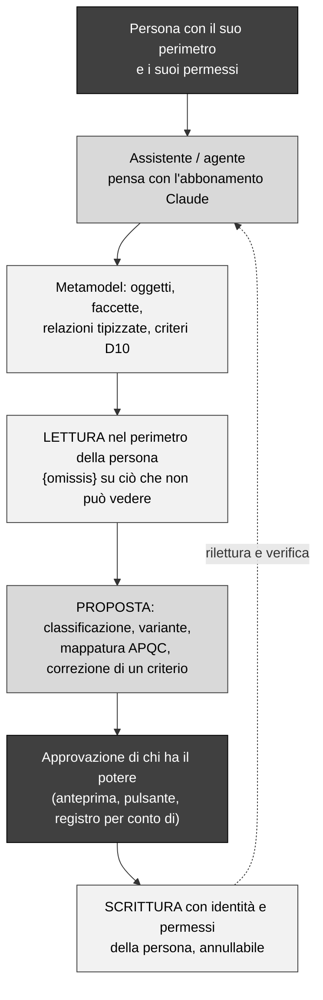

| che cosa fa l'agente | come usa il metamodel | classe e limite |
|---|---|---|
| **Descrive** un processo a una persona | legge la scheda canonica (D5) e racconta confini, ruoli, decisioni, KPI nel linguaggio della persona | lettura, nel perimetro della persona (ADR-0040, ADR-0050 D6); `{omissis}` su ciò che non può vedere |
| **Verifica la robustezza** di un blueprint | applica gli otto criteri di D10 e restituisce l'elenco dei difetti, uno per criterio | lettura e calcolo, nessuna scrittura |
| **Classifica** un processo | propone i valori delle faccette di D4 con il criterio e la fonte | proposta; scrive solo dopo l'approvazione |
| **Mappa** verso APQC | propone un `è_mappato_a` con il tipo di corrispondenza (esatto, più ampio, più ristretto, parziale) | proposta con provenienza; approvazione umana |
| **Distingue variante e parametro** | applica la regola di D6 a un caso del consolidamento e consiglia la strada | consiglio; la decisione resta del titolare del potere (ADR-0059) |
| **Risolve chi fa che cosa** | dal ruolo di processo alla posizione configurata alla persona alla data (D8) | lettura; i dati di persone altrui seguono il perimetro (I16-I20) |
| **Costruisce un'applet di lavoro** | usa le righe di lavoro e il catalogo delle azioni di ADR-0060 per portare un problema fino alla correzione (per esempio i processi senza responsabile in carica) | classi A/B/C di ADR-0056; niente codice generato; il pulsante rosso scrive |
| **Segnala un difetto o una lacuna** | scrive una richiesta in coda con la voce di metamodel mancante | richiesta; ogni richiesta passa dal sì di Enzo (regola del 2026-11-15) |

Regole che restano ferme:

1. **Nessuna chiave API**: l'agente pensa con l'abbonamento Claude di Enzo; il fornitore del modello lo sceglierà Enzo quando i repo si apriranno al pubblico (ADR-0056 D3, principio P24, `CLAUDE.md`).
2. **Nessuna scrittura da solo** su dati del cliente: classi e capacità di ADR-0053, registro «per conto di», ritorno provato.
3. **Le decisioni sul modello** (varianti, nuovi vocabolari, nuove relazioni) sono di chi ha il mandato per il modello; un tenant non cambia il modello (ADR-0059, ADR-0048).
4. Per ogni capacità nuova dell'agente sul metamodel vale il catalogo di operazioni (`docs/kb/atlas/agent-operations.json`) e il perimetro di `docs/kb/agent-perimetri.json`; l'estensione si verifica con `python docs/kb/tools/check_concetti_agente.py`.

## §7 — Piano di attuazione a passi piccoli

Regola di Enzo del 2026-11-21: lavoro progressivo a passi piccoli, autonomi, ciascuno rilasciato da solo e verificabile subito nel browser; mai un piano realizzato tutto insieme. Questo ADR dunque **non** ordina nessuna migrazione: ordina un percorso. Ogni passo è un lavoro a sé, con la sua prova dal vivo (ADR-0026) e la sua accettazione.

| passo | che cosa | prova dal vivo | tocca il database |
|---|---|---|---|
| 1 | **Glossario unico** dei processi: una pagina e un testo che dicono i cinque sensi di «processo» e come D2 li ordina; le pagine che contano processi dichiarano quale oggetto contano | l'elenco delle pagine e dell'oggetto contato, come Valentina Conti | no |
| 2 | **Vocabolari delle faccette** (D4): finalità, beneficiario, perimetro, modalità, attivazione, partecipazione tecnologica, standardizzazione, come tabelle di riferimento piccole e `varchar + CHECK` | classificazione dei 21 processi di RTL, mostrata e modificabile da chi ha il potere | sì, additivo |
| 3 | **Controllo di pubblicazione** (D10): un controllo di integrità che per ogni processo del modello elenca i criteri non soddisfatti; sola lettura | l'elenco dei difetti per processo, per `FIN_BANKING` | no |
| 4 | **Mappatura APQC con tipo** (D7, `è_mappato_a`): esatto, più ampio, più ristretto, parziale; le 131 attività di RTL vengono dal catalogo APQC PCF Banking (ADR-0049), e il tipo di corrispondenza di ciascuna va dichiarato, non presunto | la mappatura mostrata nella scheda del processo | sì, additivo |
| 5 | **Compiti L5** solo per le attività che ne hanno bisogno (un caso reale per volta) | un'attività di RTL con i suoi compiti, mostrata e verificata | sì, additivo |
| 6 | **Relazioni tipizzate** con condizioni, validità e provenienza, a partire da `precede`, `richiama`, `è_eseguito_da` | il flusso di un processo letto dalle relazioni | sì, additivo |
| 7 | **Ruoli di processo astratti e regole di collegamento alle posizioni** (D8) nella configurazione del tenant | un ruolo di processo risolto in una persona alla data, per un processo di RTL | sì, additivo |
| 8 | **Istanza con versione e configurazione registrate** (D10, criterio 7) per le richieste di approvazione legate a un processo | una richiesta ricostruita con la versione del blueprint e la configurazione che l'hanno governata | sì, additivo |
| 9 | **Componenti riutilizzabili con contratto** (D6) | un componente richiamato da due processi | sì, additivo |
| 10 | **Agente sul metamodel**: le capacità di §6, una alla volta, nel catalogo e nei perimetri | la prova dell'assistente come Valentina Conti su un processo di RTL | no, salvo il catalogo |

Ordine e contenuto dei passi si possono cambiare con una decisione di Enzo senza riscrivere questo ADR: l'ADR fissa il metamodello, non il calendario. I passi 5-9 si fanno solo quando un caso d'uso reale li richiede.

**Fuori da questo ADR** (voci che si possono proporre in un ciclo successivo): importazione ed esportazione BPMN, DMN e CMMN; il disegno grafico del metamodel (editor visuale); l'uso del metamodel per processi non HR di altri tenant; la relazione fra i processi e i comitati.

## §8 — Misure e comandi

I numeri dello stato attuale non stanno in questo ADR: si ricavano. Comandi (in sola lettura; sul gemello o dal tunnel, secondo `CLAUDE.md`):

| che cosa | comando |
|---|---|
| processi attivi per livello del tenant | `select tenant_process_level, count(*) from sys.sys_tenant_processes where tenant_process_tenant_id = '<tenant>' and tenant_process_is_active group by 1;` |
| attività per processo | `select tenant_process_step_process_id, count(*) from sys.sys_tenant_process_steps group by 1;` |
| processi del modello per versione | `select blueprint_process_variant_id, count(*) from sys.sys_blueprint_process_registry group by 1;` |
| partecipazioni ai processi | `select count(*) from sys.sys_process_participants;` |
| processi senza responsabile in carica | la lente `processi-senza-responsabile` in `apps/api/src/modules/quadro/lenti.ts` |
| stato dell'indice degli ADR | `python docs/kb/tools/build_adr_index.py --check` |
| conteggi del repo | `docs/kb/SOT_STATE.md` |

I nomi delle colonne nelle interrogazioni sono quelli dello schema alla data di questo ADR; se non coincidono, vale lo schema.

## §9 — Alternative considerate

1. **Un solo albero di processi con ogni dimensione come ramo.** Scartata: la classificazione per dimensioni indipendenti non è una gerarchia, e forzarla in un albero duplica i nodi (un processo con beneficiari interni ed esterni starebbe in due rami).
2. **Adottare APQC PCF come modello unico.** Scartata: APQC è un riferimento di classificazione, non un metamodel di configurazione, ruoli e versioni. Si usa per ciò che sa fare (D9) tramite `è_mappato_a`.
3. **Descrivere i processi solo con BPMN.** Scartata: BPMN rappresenta flussi, non copre da sola responsabilità, KPI, competenze, governance e configurabilità. È una proiezione (D9).
4. **Nominare persone nel blueprint.** Scartata: contraddice I1 e ADR-0044 e rende il blueprint non riutilizzabile fra tenant.
5. **Una variante per ogni differenza fra tenant.** Scartata: moltiplica le varianti e le fa divergere; la regola di D6 tiene le differenze di valore nella configurazione.
6. **Costruire tutto il metamodel in un unico lavoro.** Scartata per regola di Enzo (passi piccoli, 2026-11-21) e per il rischio di dati vuoti (§5).

## §10 — Accettazione e scelte registrate

L'ADR è accettato da Enzo; l'accettazione vale per la forma di D1-D10 e non per il calendario di §7. Per cambiare una decisione si scrive un nuovo ADR che dichiara di superare questo (convenzione di `docs/architecture/ADR_INDEX.md`). Enzo ha accettato l'ADR il 2026-11-22 con le raccomandazioni qui sotto, che diventano le scelte registrate:

| # | questione | scelta registrata |
|---|---|---|
| Q1 | I compiti L5 entrano subito come tabella o solo dove servono (passo 5)? | solo dove servono, un caso reale per volta |
| Q2 | Il primo passo è il glossario unico (passo 1) o il controllo di pubblicazione (passo 3)? | glossario unico: costa poco, si vede subito nel browser e toglie la confusione sui conteggi |
| Q3 | Il controllo di pubblicazione (D10) diventa un cancello di integrità rosso, o resta un rapporto? | rapporto per `FIN_BANKING`, cancello solo quando i difetti noti sono chiusi |
| Q4 | Chi può classificare un processo (faccette, corrispondenza con APQC) se il suo profilo non porta `bpm_process:update`? Su RTL 13 responsabili su 21 processi attivi non avevano PROCESS_OWNER (misura del 2026-11-22). | Enzo, 2026-11-22: il responsabile in carica del processo, cioè chi regge oggi la sua posizione responsabile, lo classifica anche senza il ruolo; il potere viene dal dato e segue da sé i cambi di persona. Codice: `requirePermissionOr` in `apps/api/src/middleware/rbac.ts`, `presidiaIlProcesso` in `apps/api/src/modules/tenant-processes/service.ts`. Il cambio del responsabile resta legato al permesso. |
| Q5 | Il mandato HR (HRMS_MANAGER, TENANT_ADMIN) può scrivere tramite l'assistente? | Enzo, 2026-11-22: no, ADR-0050 D6 non si emenda. Chi ha il potere solo per mandato scrive dalla pagina; l'API risponde `AGENT_MANDATE_ONLY` e l'assistente glielo dice, mentre a chi il potere non ce l'ha dice che può farlo chi ha la responsabilità dei dati. |
